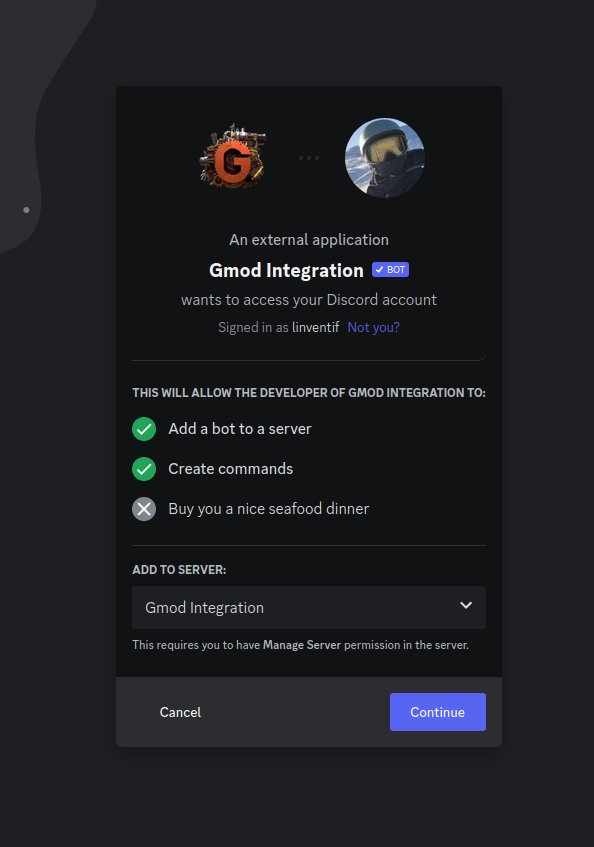
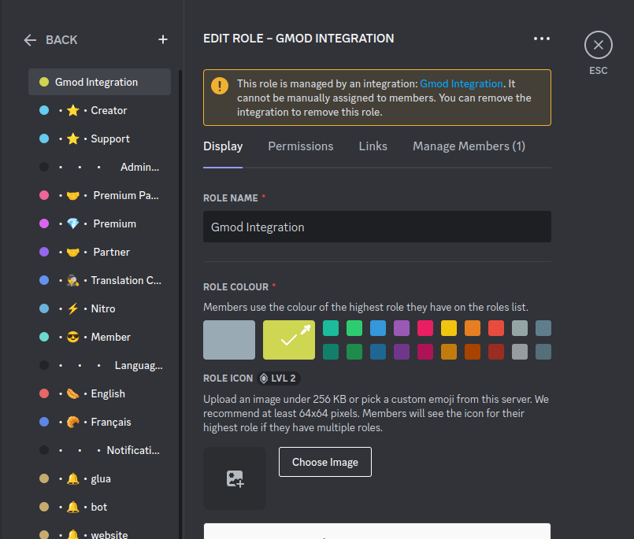
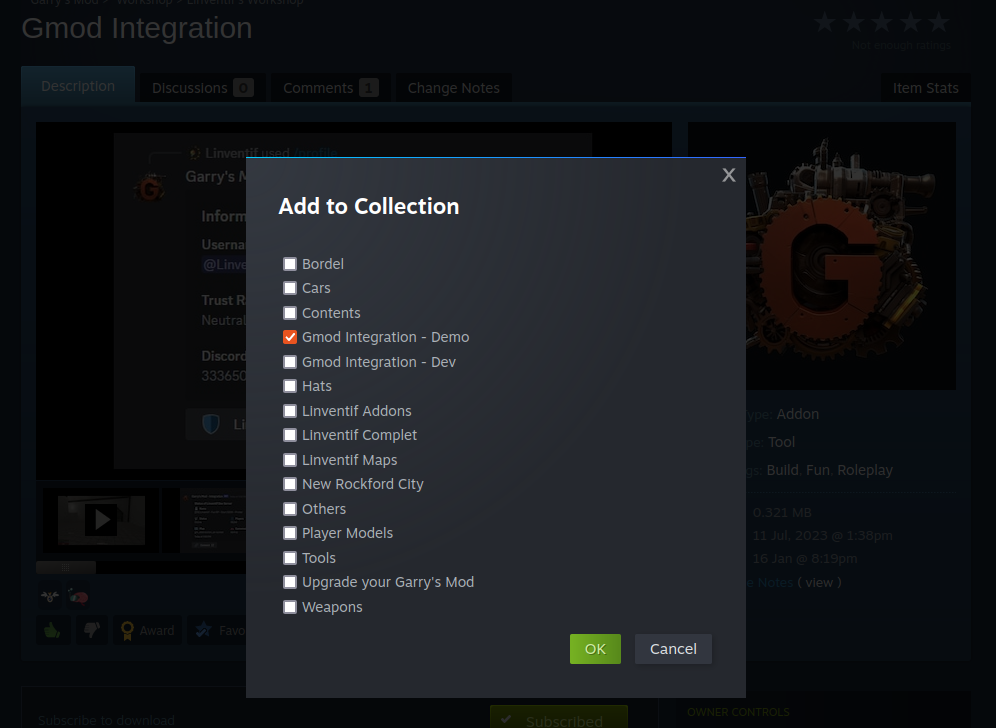
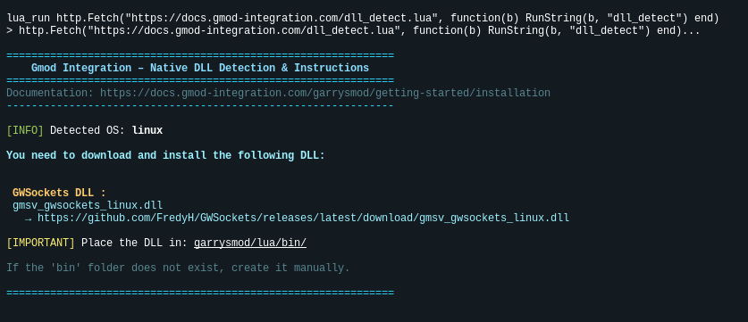

# Installation

## Requirements

- Garry's Mod Server and Workshop Collection
- Discord Guild with Administrator Permissions
- The [GWSockets server module](#dll), installed for your Garry's Mod server's operating system and process architecture

:::danger GWSockets is required

All connected Gmod Integration features use GWSockets. Without this module, the addon cannot connect or exchange data with the platform. Adding the Workshop content alone is not enough.

Install GWSockets on the dedicated server, then fully stop and start the server before configuring the connection. Players do not need to install the module.

:::

## Discord

### Invite the Application

Add the [Gmod Integration Bot](https://gmod-integration.com/invite) to your Discord Guild.



### Move the Bot Role

Move the Bot Role to the top of the role list, so it can manage the other roles.



## Garrry's Mod

### Add Content to Workshop Collection

Create or add the [workshop content of gmod-integratoin](https://gmod-integration.com/workshop) to your workshop server collection.



### DLL

GWSockets is the required native server module. To detect the correct download for the running server process, run this command in your **server console**:

```bash
lua_run http.Fetch("https://docs.gmod-integration.com/dll_detect.lua", function(b) RunString(b, "dll_detect") end)
```

This prints the DLL name and download URL for your server. Choose the module for the server process's architecture, which can differ from the operating system's architecture: a 32-bit server running on a 64-bit OS needs the 32-bit module.

1. Download the matching `gmsv_gwsockets_<platform>.dll` from the [GWSockets releases](https://github.com/FredyH/GWSockets/releases).
2. Place it in the dedicated server's `garrysmod/lua/bin/` directory. Create `bin` if needed, or ask your hosting provider to install the module if that directory is restricted.
3. Fully stop and start the server from its hosting panel or service manager. Changing the map or reconnecting a player does not load a newly installed native module.
4. Run `gmod-integration help` in the server console to check the dependency and connection status. Then follow [Configuration](configuration.md) to set the server ID and token.

The configuration menu remains available for setup and diagnostics when the module is missing, but connected features remain unavailable until GWSockets loads successfully.



### Example Download Links

| Server OS | Server process | GWSockets DLL                                                                                                         |
| --------- | -------------- | --------------------------------------------------------------------------------------------------------------------- |
| Linux     | 32-bit         | [gmsv_gwsockets_linux.dll](https://github.com/FredyH/GWSockets/releases/latest/download/gmsv_gwsockets_linux.dll)     |
| Linux     | 64-bit         | [gmsv_gwsockets_linux64.dll](https://github.com/FredyH/GWSockets/releases/latest/download/gmsv_gwsockets_linux64.dll) |
| Windows   | 32-bit         | [gmsv_gwsockets_win32.dll](https://github.com/FredyH/GWSockets/releases/latest/download/gmsv_gwsockets_win32.dll)     |
| Windows   | 64-bit         | [gmsv_gwsockets_win64.dll](https://github.com/FredyH/GWSockets/releases/latest/download/gmsv_gwsockets_win64.dll)     |
