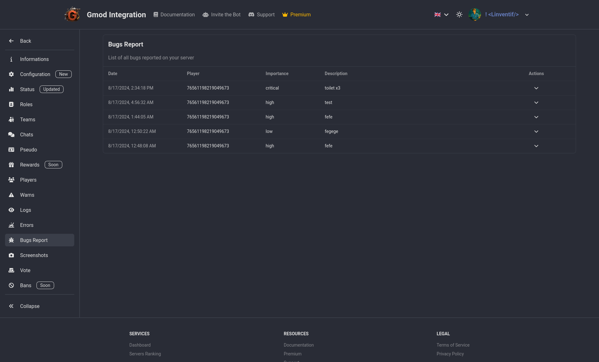

# Bug reports

Read reports submitted by players in game, including their date, author, importance, description,
expected and actual results, reproduction steps and optional screenshot.

## Send bug reports to Discord

In **Bug reports on Discord**, choose **Select channel**, select a text channel and confirm.
The bot needs **View Channel**, **Send Messages** and **Embed Links** in that channel.

New reports are saved to the panel and sent to the selected channel with their importance,
description, expected and actual results, and reproduction steps. A saved screenshot is shown when
available. Long report text is shortened on Discord; the complete report remains in the panel.
Selecting a channel does not publish old reports.

Use **Remove destination** to stop sending notifications. The Discord channel, saved reports and
screenshots remain available. Discord delivery failures do not discard a player's report.

