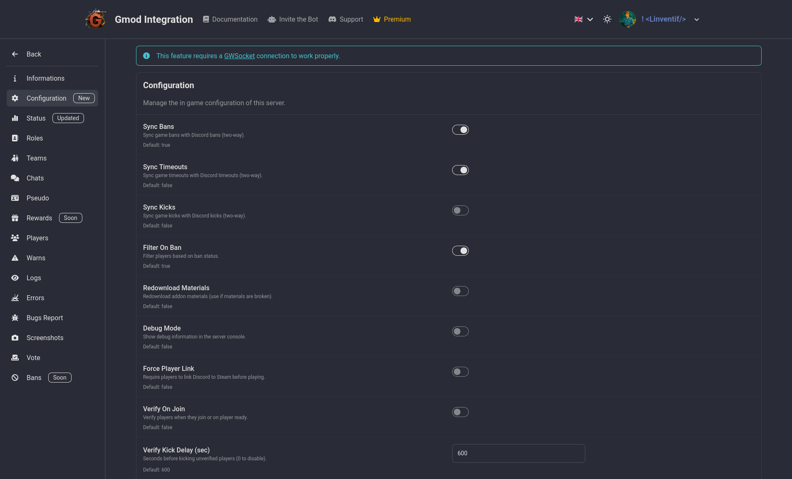

# Configurations

Configure your gmod server from here, you can force a specific game version, sync ban, force players to have a discord account linked to their gmod account to join the server, and more.

## Whitelist mode

In **General and administration**, enable **Whitelist mode** to restrict who can join your server.
Choose a Discord role in **Server whitelist** to allow linked players who hold that role in your
Discord community. Players must link their Steam and Discord accounts for this role to provide access.

Manual whitelist entries on the **Players** page remain independent. Removing a role does not remove
a player's manual entry. When a player loses the role and has no other whitelist or administrator
permission, the integration denies new connections and removes the player from the game while
whitelist mode is enabled. Disabling whitelist mode restores normal connection rules.

Use the matching current addon and the required GWSockets library for live access updates.
