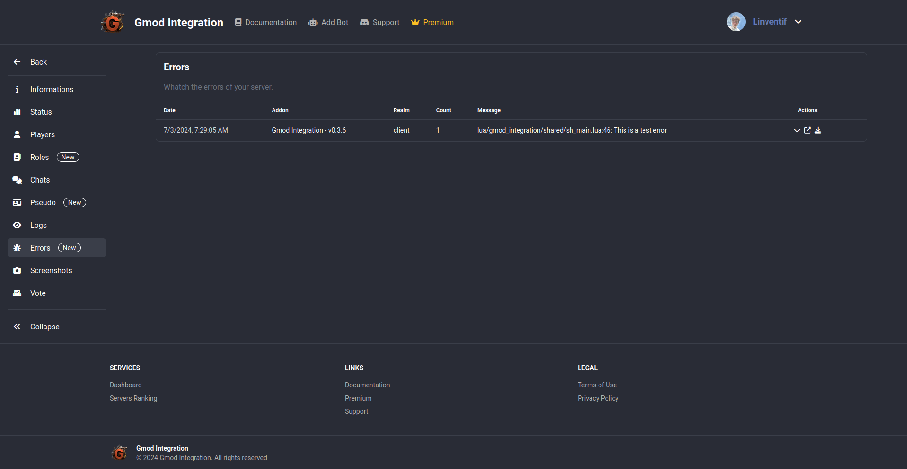

# Errors

View error messages, dates and stack traces reported by your game server and players to investigate
their cause.

## Send Lua errors to Discord

On **Lua errors**, choose **Select channel** in the Discord destination card, select a text channel
and confirm. The bot needs **View Channel**, **Send Messages** and **Embed Links** in that channel.

New server and player-client reports are saved to the panel and sent to the selected channel with
their source, error message, stack trace and occurrence count. Long messages are shortened on Discord;
the full report remains available in the panel. Selecting a channel does not send old reports.

Use **Remove destination** to stop future notifications. This keeps the Discord channel and the
saved error history. Discord delivery failures do not discard reports from the panel.

