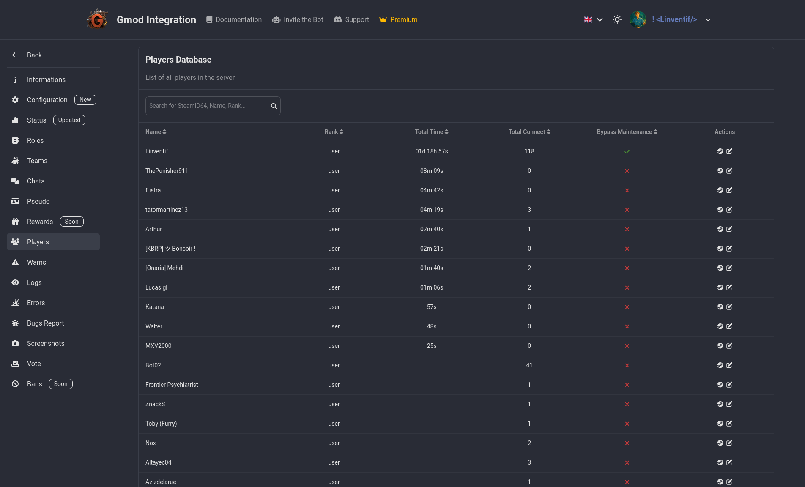

# Players

View recorded players, their playtime and ranks, and search for a specific player. Edit a player to
grant or remove **Manual whitelist access**.

A manual entry allows that player to join while **Whitelist mode** is enabled. Access granted by the
configured **Server whitelist** Discord role is independent: removing the manual entry preserves a
valid role grant, and losing the role preserves a manual entry. Players with no remaining access are
denied entry and removed from the game while whitelist mode is enabled.

