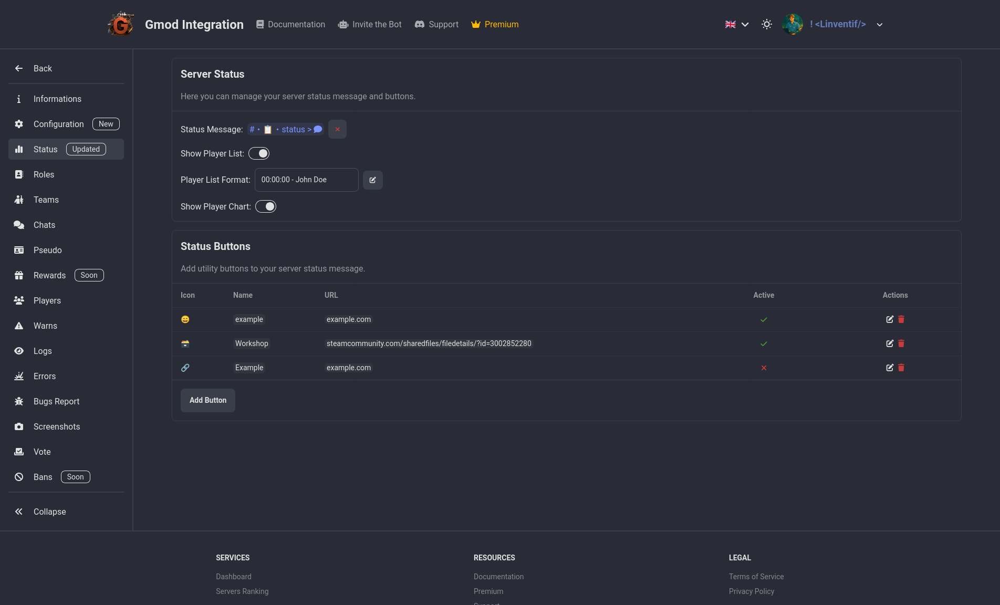
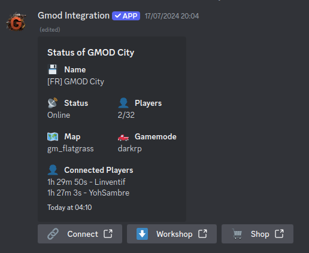

# Status

In the status section, you can create an automatically refreshed Discord message with your server's
name, connection status, player count, map and game mode. You can also show a player list with a
custom format, and enable the activity chart with Premium.

The live preview sits to the right of the configuration on wide screens, and below it on mobile.
It updates as you change the player-list format, options or custom buttons, including their labels,
emojis and activation. Five fictional players let you test the format even when the game server is
offline. They exist only in the simulation: the message sent to Discord uses your server's real data
and the bot's message language.

Changes remain drafts until you select **Save**. To create the message, choose **Send Status**, select
a Discord channel, review the preview, then select **Send to Discord**. Choosing the channel alone
does not publish a message. Canceling an edit discards that edit.

Custom link buttons can point to your rules, website or Workshop collection. An online server also
gets the bot's connection button. Buttons inside the preview are inactive so you can inspect them
without opening links or launching the game.

