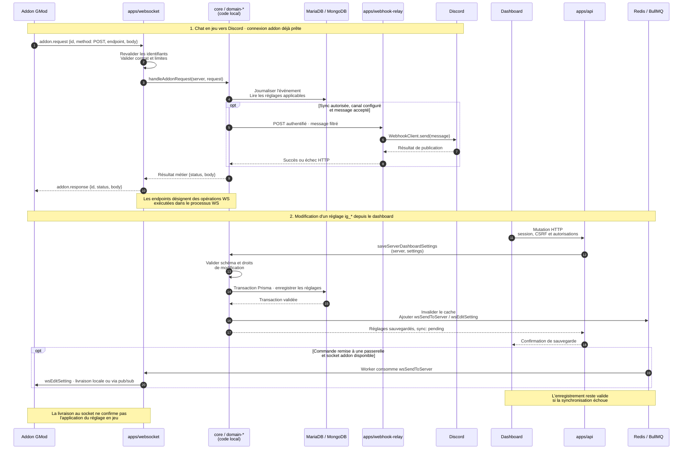

# Architecture

## Overview

This repository is a **Turbo + Bun monorepo**. It is the backend + frontend for "Gmod Integration": a product
that connects a Garry's Mod dedicated server to Discord (player verification, role/nickname sync, chat relay,
server status, RCON from Discord, moderation, statistics, ...).

For the illustrated guide in French, start with [the architecture diagrams](./architectures/README.md):
system overview, addon and dashboard connections, application flows, BullMQ, WebSocket delivery,
package dependencies and production deployment.

Two things live outside plain "web app" territory and shape most of the design decisions below:

- The actual game server integration is a **Lua addon** running inside Garry's Mod, versioned as a separate
  git submodule ([`submodules/gmod-integration`](../submodules/gmod-integration), see
  [docs/submodules/gmod-integration.md](./submodules/gmod-integration.md)). It is the client of everything in
  this monorepo.
- The Discord bot needs a single, persistent `discord.js` gateway connection — you cannot have multiple
  processes logging in with the same bot token without fighting over the gateway. That constraint drives the
  app split and the BullMQ bridge described below.

## Why this shape

### Why separate `apps/api`, `apps/discord`, `apps/websocket`?

Each has a different runtime profile:

- `api` is stateless HTTP — trivially horizontally scaled (target `2/2` replicas in prod, see
  [deployment/swarm.md](./deployment/swarm.md)).
- `discord` holds the one live `discord.js` client (main bot) plus per-guild custom bot clients — it is not
  stateless and cannot be scaled the same naive way.
- `websocket` holds long-lived socket state per connected GMod server / dashboard client, in memory, per
  process.

Splitting them means a crash or redeploy of one doesn't take the others down, and each can be scaled/tuned for
its own workload independently.

### Why go through BullMQ instead of calling Discord directly from `api`?

Only `apps/discord` is logged into Discord. If `api` (or `core`/`domain-*`) needs a Discord-side effect —
create a channel, fetch a Discord user, sync a role, upload a screenshot to a channel — it cannot just import
`discord.js` and act; there is no live client there, and logging in a second client with the same token causes
gateway conflicts. So instead:

1. The caller enqueues a job on a BullMQ queue (`packages/infra-bullmq`).
2. `apps/discord`'s worker consumes it and executes the action with the live client.
3. If the caller needs a result, it's written to a Redis key `bullmq:reply:<correlationId>` and the caller
   polls for it (with a timeout — `BullMQReplyTimeoutError`).

This keeps the Discord client as the single owner of the Discord connection while letting every other app
trigger Discord-side effects without a heavier synchronous RPC framework.

Discord webhook publication is a separate path: shared models call the standalone
[`apps/webhook-relay`](./apps/webhook-relay.md) over authenticated HTTP. That service sends webhook
messages without logging in a bot and does not use the Discord BullMQ bridge.

### Why `websocket` as its own app instead of Socket.IO bolted onto `api`?

GMod servers keep a persistent WebSocket open to receive push messages (config changes, live status) and to
push events up without polling. Because `websocket` can run multiple replicas, a message addressed to a given
server might need to be delivered by a _different_ replica than the one that owns that server's socket — that's
why `wsSendToServerQueue` messages that aren't found locally are re-broadcast over a Redis pub/sub channel with
a short-lived ack key, instead of assuming the local process has the connection.

### Why both MariaDB (Prisma) and MongoDB?

MariaDB via Prisma (`packages/infra-prisma`) is the relational source of truth: servers, guilds, users, bans,
warns, config. MongoDB (`packages/infra-mongo`) holds high-volume, loosely structured data that would bloat a
relational table — primarily `gm_server_logs` (in-game chat/kill/event logs).

### Why is the Redis role split into cache / pub-sub / BullMQ backing store?

It's one Redis instance doing three jobs: BullMQ's own queue storage, short-TTL caching of hot lookups (e.g.
guild locale, Discord guild snapshots), and pub/sub for cross-replica WebSocket delivery. There's no dedicated
message broker beyond Redis — it was judged not worth the operational cost for this scale.

### Why is the GMod addon a separate submodule, not part of this workspace?

It's a different language/runtime (GLua, not Node/TypeScript) with its own release pipeline: GMA packaging for
Steam Workshop, its own auto-release GitHub Action, its own AGENTS.md and lint conventions (realm prefixes
`sv_`/`cl_`/`sh_`, no stock-Lua formatter). Bundling it into the Bun/Turbo workspace would gain nothing and
risk tooling collisions.

## Repo map

```text
apps/
  api        -> HTTP API (Express). Website, webhooks, and legacy addon HTTP compatibility.
  discord    -> Discord bot(s) (main + per-guild custom) + BullMQ workers that execute Discord actions.
  websocket  -> WebSocket gateway: live connections to GMod servers and dashboard clients.
  webhook-relay -> standalone service posting to Discord webhooks for core (own image/env, no @gmod/*).
  website    -> Frontend (SolidJS/Vite): public site + dashboard.
  docs       -> Docusaurus site that publishes the PUBLIC product documentation (not this ./docs folder).

packages/
  config       -> env loading + Zod validation, single source of truth for config.
  schema       -> Zod contracts (BullMQ payloads, GMod entities, DB-facing shapes).
  shared       -> low-level BaseClass validation, secure token generation and operational logging.
  core         -> cross-cutting application logic: v3 API models, DB helpers, logging/localization/format utils,
                  shared Express request types.
  domain-*     -> domain-oriented business logic (server, guild, user, moderation, compliance, gmod entities).
  infra-*      -> technical adapters (Prisma/MariaDB, Mongo, Redis, BullMQ, MinIO/S3, Steam API, WS queues).
  locales      -> raw translation JSON, consumed by core's localization utils and the website.

submodules/
  gmod-integration -> the Garry's Mod Lua addon. Separate repo, separate toolchain, separate release pipeline.
```

Per-folder detail: see [docs/README.md](./README.md) for the full docmap with a link to a dedicated page for
every app and package.

## End-to-end data flow

More diagrams (system overview, the BullMQ request/reply bridge in detail, WebSocket cross-replica delivery,
package dependency layers, production deployment topology) live in
[docs/architectures/](./architectures/README.md), each with a standalone `.mmd` source file.



In words:

1. The current GMod addon authenticates its WebSocket with server `id` and `token` headers, waits for
   `addon.ready`, then exchanges correlated `addon.request` / `addon.response` messages. The gateway
   invokes shared core models in its own process. Legacy HTTP routes remain available for older addons.
2. Shared models enforce server scope, feature permissions and validation, then use MariaDB (Prisma),
   MongoDB (server logs), Redis or MinIO as needed. Game-to-Discord chat uses the authenticated HTTP
   webhook relay; Discord bot actions use the BullMQ workers.
3. Dashboard changes go through the HTTP API with application-session and authorization checks, plus
   CSRF protection for cookie-authenticated mutations. Settings are committed before external updates.
   An `ig_*` setting queues `wsEditSetting` through BullMQ; `sync: pending` does not confirm application
   by the game server.
4. The dashboard obtains a single-use WebSocket ticket from `POST /v6/auth/ws-ticket`. The gateway
   atomically consumes it and revalidates the application session and permissions for scoped messages
   and live pushes. Delivery to addon sockets can use Redis pub/sub across gateway replicas.

## Allowed dependencies

General rule: only "downward" dependencies.

- `apps/*` can depend on `packages/*`.
- `shared` has no domain, core, infrastructure-client or app dependencies. Only its logger reads `config`.
- `core` can depend on `domain-*`, `infra-*`, `shared`, `config`, and `schema`.
- `domain-*` can depend on `infra-*`, `shared`, `config`, and `schema`. Compliance exports and moderation localization currently use specific core modules; their actual and declared dependencies must remain acyclic.
- `infra-*` must not depend on `apps/*`.
- `schema` should only depend on validation libraries (`zod`).

The architecture check (`bun run check:architecture`) examines workspace manifests and source imports
together. It rejects cross-application imports, undeclared workspace imports and dependency cycles.

## Critical boundaries

### Discord boundary

- Discord bot actions triggered outside `apps/discord` must go through BullMQ. Webhook publication
  uses the standalone HTTP relay described above.
- Use `@gmod/infra-bullmq/discordQueueAdapters.js`.
- Define/update payloads in `packages/schema/src/bullmq.ts`.
- Implement worker handlers in `apps/discord/src/discord/workers/discordQueueWorkers.ts`.

### Config boundary

- Single source of truth: `@gmod/config`.
- `@gmod/config` loads workspace `.env` files and validates with Zod.
- Avoid reading `process.env` directly outside config (except the standalone webhook relay).
- Infrastructure adapters use `@gmod/config/infrastructure.js` getters, which accept an explicit environment for isolated tests and do not bootstrap unrelated service credentials.

### Data boundary

- Prisma client is generated in `packages/infra-prisma/generated/prisma`.
- Import Prisma client through `@gmod/infra-prisma`.
- Do not duplicate Prisma clients in apps.

## Composition patterns

### API endpoint pattern

1. Route (`apps/api/src/routes/*`)
2. Validation/Auth middleware (`apps/api/src/middleware/*`)
3. Thin controller (`apps/api/src/controllers/*`)
4. Extracted logic in `packages/core/src/models/*` or `packages/domain-*`

### WebSocket pattern

- Asynchronous sending through BullMQ queues (`@gmod/infra-websocket/queues.js`).
- Processing in the websocket app via workers, with a Redis pub/sub fallback for cross-replica delivery.

### Global Express typing

- `Request` extensions (`req.server`, `req.panelUser`, etc.) are centralized in:
  - `packages/core/src/types/express.d.ts`

## Anti-patterns to avoid

- Importing `apps/discord/...` from API/core/domain.
- Heavy business logic in controllers/routes.
- Duplicating payload schemas outside `packages/schema`.
- Introducing new cycles between domain packages.
- Adding Lua/GMod-addon changes to this workspace instead of the `submodules/gmod-integration` submodule.
