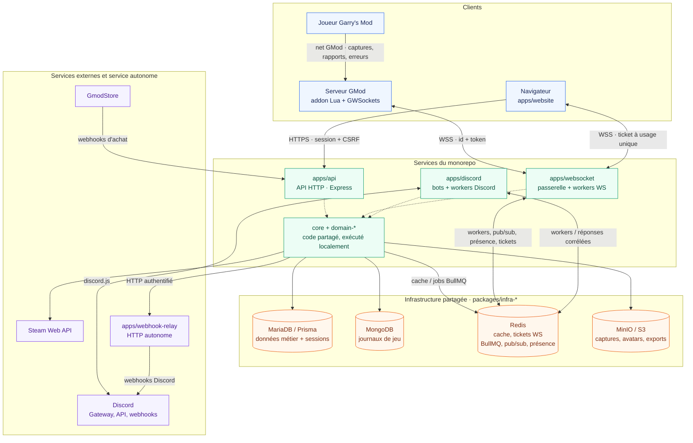
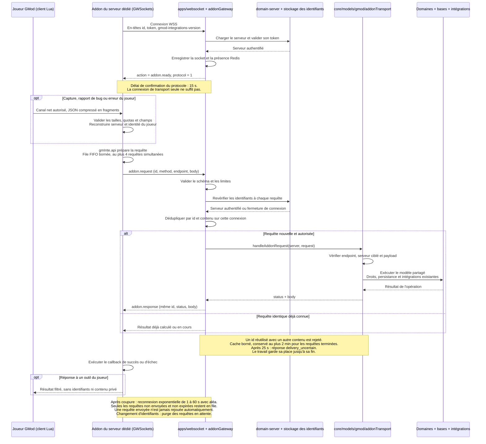
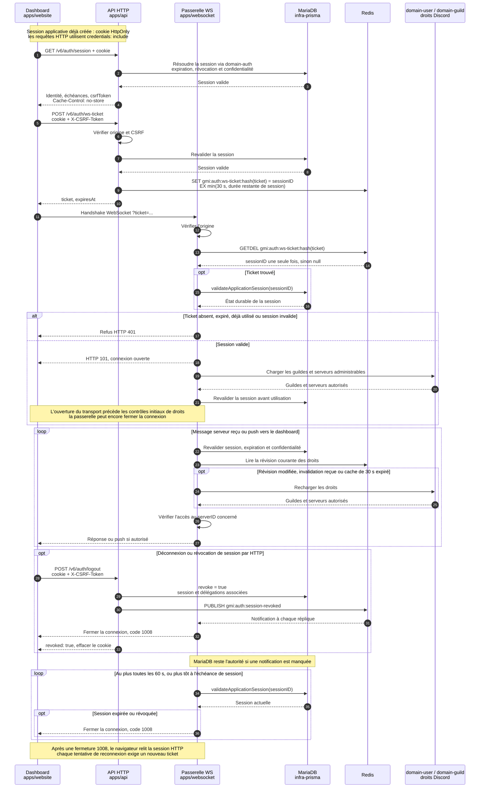
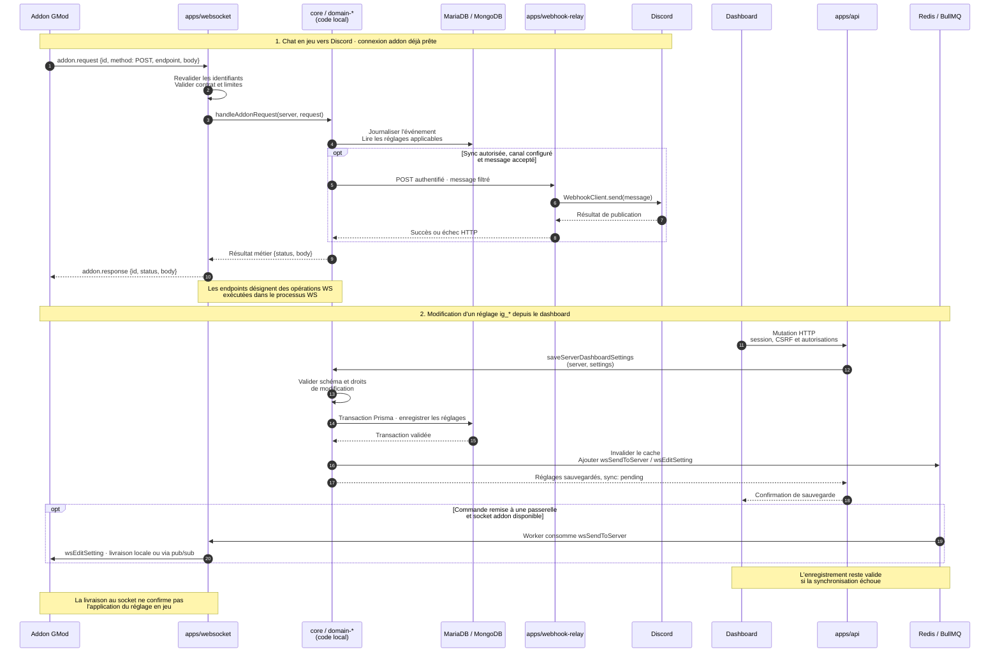
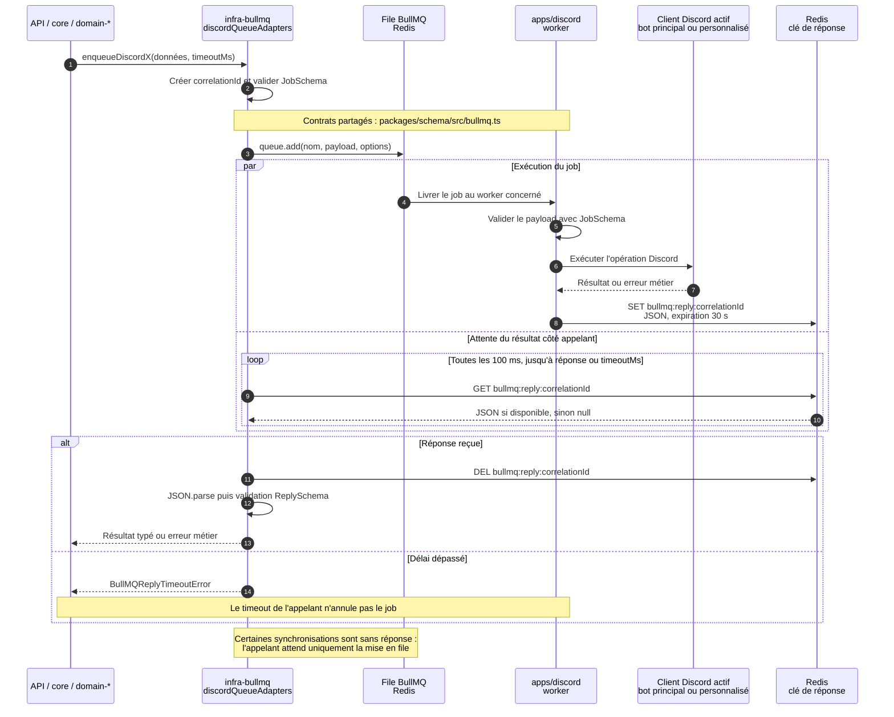
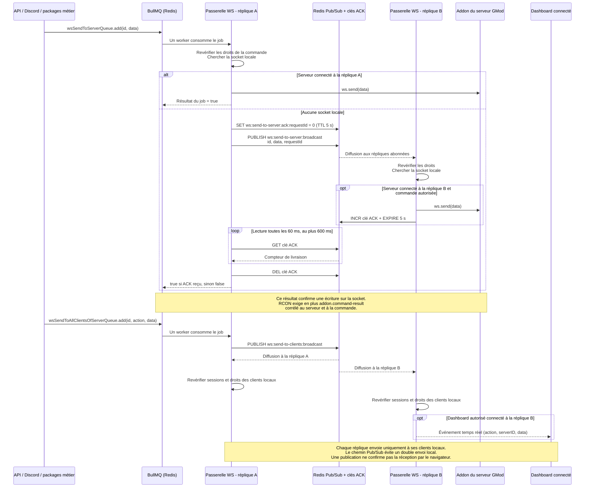
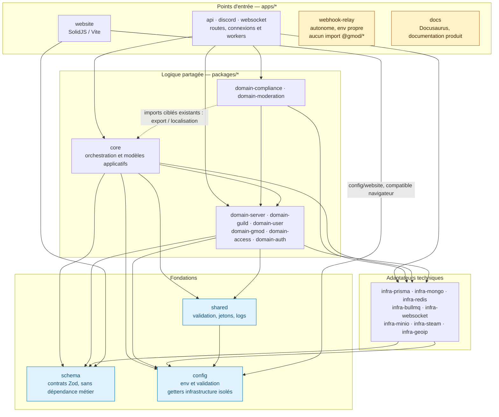
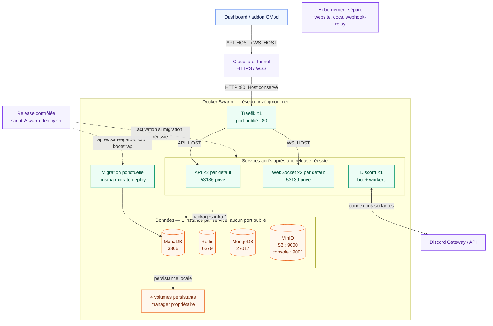

# Schémas d'architecture

Guide visuel de l'implémentation actuelle de Gmod Integration. Les vues complètent
[l'architecture détaillée](../architecture.md) et la [carte du dépôt](../README.md).
Les fonctionnalités proposées dans la [spécification v6](../v6-specification.md) restent distinctes
de l'architecture implémentée représentée ici.

Chaque schéma est affiché ci-dessous dans un bloc Mermaid, lisible sur GitHub et dans un aperçu
Markdown compatible. Son fichier `.mmd` est la source modifiable, utilisable dans un éditeur Mermaid.

| Vue                                                                           | Ce qu'elle explique                                             |
| ----------------------------------------------------------------------------- | --------------------------------------------------------------- |
| [Vue globale](#1-vue-globale)                                                 | Services, clients, intégrations et stockage.                    |
| [Connexion de l'addon](#2-connexion-de-laddon)                                | Authentification, protocole WS, relais joueur et reconnexion.   |
| [Session du dashboard](#3-session-du-dashboard)                               | Session HTTP, CSRF, ticket WS et révocation.                    |
| [Flux applicatifs](#4-flux-applicatifs)                                       | Chat vers Discord et modification de configuration.             |
| [Actions Discord via BullMQ](#5-actions-discord-via-bullmq)                   | Jobs, validation, réponses corrélées et timeout.                |
| [Livraison WebSocket entre instances](#6-livraison-websocket-entre-instances) | Diffusion Redis, ACK et notifications dashboard.                |
| [Organisation du code](#7-organisation-du-code)                               | Dépendances entre apps, domaines, infrastructure et fondations. |
| [Mise en production](#8-mise-en-production)                                   | Swarm, routage, persistance, sauvegarde et migrations.          |

## 1. Vue globale

Source modifiable : [`system-overview.mmd`](./system-overview.mmd).

Les services, leurs clients et les données partagées. Le nœud `core + domain-*` représente du code
importé dans chaque processus : les flèches pointillées sont des appels locaux. Les autres flèches
montrent les échanges réseau ou les accès aux données. Les bases passent par `packages/infra-*`.

L'addon courant échange avec la passerelle WebSocket. Le dashboard utilise l'API HTTP et un ticket
pour sa connexion WS. Les actions du bot passent par BullMQ ; les publications par webhook utilisent
le relais HTTP autonome.

À lire avec [l'architecture générale](../architecture.md),
[le contrat addon](../packages/addon-transport.md) et [le relais webhook](../apps/webhook-relay.md).

## 2. Connexion de l'addon

Source modifiable : [`addon-connection.mmd`](./addon-connection.mmd).

De l'authentification du serveur dédié jusqu'au callback Lua, avec le relais des captures, rapports
et erreurs des joueurs. `method` et `endpoint` désignent une opération du protocole WS ; la passerelle
appelle directement les modèles partagés.

La déduplication est bornée à une connexion. Après une coupure, seules les requêtes encore non envoyées
et non expirées peuvent rester en attente. Un résultat `delivery_uncertain` ne permet pas de conclure
que l'opération a échoué.

Sources : [gateway addon](../../apps/websocket/src/addonGateway.ts),
[dispatcher partagé](../../packages/core/src/models/gmod/addonTransport.ts) et
[contrat de transport](../packages/addon-transport.md).

## 3. Session du dashboard

Source modifiable : [`dashboard-session.mmd`](./dashboard-session.mmd).

Le dashboard commence avec une session applicative HTTP. Il récupère un jeton CSRF puis demande
un ticket WebSocket à usage unique, valable au plus 30 secondes. Redis consomme ce ticket atomiquement
avec `GETDEL` lors du handshake.

Le ticket établit l'identité de la connexion. Les sessions et les autorisations continuent d'être
vérifiées pendant son utilisation, avec révocation partagée entre les instances.

Sources : [sessions et tickets](../../packages/domain-auth/src/authSessions.ts),
[passerelle WebSocket](../../apps/websocket/src/main.ts) et
[cycle de vie des connexions](../apps/websocket.md).

## 4. Flux applicatifs

Source modifiable : [`request-flow.mmd`](./request-flow.mmd).

Deux parcours concrets : un message de chat en jeu envoyé à Discord, puis un réglage `ig_*` modifié
depuis le dashboard. Le premier utilise le relais webhook ; le second sauvegarde la configuration
en transaction avant de demander sa synchronisation au serveur de jeu.

`sync: pending` signifie que l'application du réglage en jeu reste à confirmer. Une sauvegarde validée
en base reste valide même si l'invalidation du cache ou la mise en file échoue.

Sources : [dispatch des événements addon](../../packages/core/src/models/gmod/addonTransport.ts),
[chat vers Discord](../../packages/core/src/models/v3/serversPlayersModels.ts) et
[sauvegarde des réglages](../../packages/core/src/models/v6/dashboardSettings.ts).

## 5. Actions Discord via BullMQ

Source modifiable : [`discord-bullmq-bridge.mmd`](./discord-bullmq-bridge.mmd).

Les appels `enqueueDiscordX(...)` permettent à l'API et aux modèles métier de demander une action
au processus qui possède le client Discord. Les contrats Zod sont partagés entre producteur et worker.

Pour les opérations avec réponse, l'appelant lit une clé Redis corrélée, conservée 30 secondes.
Un timeout arrête l'attente de l'appelant ; le job peut encore s'exécuter. Certaines synchronisations
attendent uniquement la mise en file.

Sources : [adaptateurs Discord](../../packages/infra-bullmq/src/discordQueueAdapters.ts),
[workers Discord](../../apps/discord/src/discord/workers/discordQueueWorkers.ts) et
[contrats de jobs](../../packages/schema/src/bullmq.ts).

## 6. Livraison WebSocket entre instances

Source modifiable : [`websocket-delivery.mmd`](./websocket-delivery.mmd).

Chaque instance de la passerelle possède ses sockets en mémoire. BullMQ confie un job à un worker ;
si la socket du serveur est ailleurs, Redis pub/sub relaie la demande et une clé ACK signale l'envoi.
Pour les dashboards, chaque instance traite la diffusion sur ses propres connexions autorisées.

L'ACK indique une écriture sur la socket. L'exécution d'une commande RCON exige en plus un
`addon.command-result` corrélé. Les notifications dashboard utilisent pub/sub sans rejeu ni accusé
de réception du navigateur : un client déconnecté peut manquer une notification.

Sources : [workers et diffusion WS](../../apps/websocket/src/main.ts),
[files WebSocket](../../packages/infra-websocket/src/queues.ts) et
[résultats des commandes addon](../../packages/infra-websocket/src/addonCommands.ts).

## 7. Organisation du code

Source modifiable : [`package-dependency-layers.mmd`](./package-dependency-layers.mmd).

Les flèches représentent des imports entre groupes de packages. Une flèche signifie qu'au moins
un membre du groupe importe un membre du groupe cible ; cette vue regroupe les dépendances pour
rester lisible. Les appels réseau entre services sont représentés dans les autres vues.

Les entrées `apps/*` composent le code partagé. Les imports ciblés de `compliance` et `moderation`
vers `core` existent actuellement et figurent en pointillés. Le relais webhook utilise sa propre
configuration et n'importe aucun package `@gmod/*`.

À lire avec [les règles de dépendances](../architecture.md#allowed-dependencies),
[la carte des packages](../README.md) et
[le contrôle automatique d'architecture](../../scripts/check-architecture.ts).

## 8. Mise en production

Source modifiable : [`deployment-topology.mmd`](./deployment-topology.mmd).

La topologie correspond à la stack Swarm versionnée et au régime attendu après une release réussie :
API et passerelle WS à deux instances par défaut, configurables, et bot Discord à une seule instance.
Traefik publie le port 80 ; les ports des services et des bases restent sur le réseau privé.

La stack laisse initialement les trois applications à zéro instance. Pour une installation existante,
le wrapper de déploiement arrête les écritures, effectue une sauvegarde à froid puis lance
`prisma migrate deploy`. Le premier déploiement avec `--bootstrap` saute la sauvegarde préalable. Il active les
applications après réussite et les laisse arrêtées en cas d'échec de migration. Les volumes locaux
imposent le placement des services de données sur leur manager propriétaire.

Le site web, la documentation produit et le relais webhook ont un hébergement séparé, absent de cette
stack. Cette vue décrit la configuration du dépôt, pas l'état réel d'un hôte. La topologie physique
Proxmox reste à documenter : aucune définition Terraform `.tf` n'est disponible dans ce dépôt.

Sources : [stack Swarm](../../docker-stack.swarm.yml),
[orchestration des releases](../../scripts/swarm-ops.py) et
[guide de déploiement et de reprise](../deployment/swarm.md).

## Mise à jour des schémas

Lorsqu'un flux, une frontière de package ou le déploiement change, modifier le fichier `.mmd` et son
bloc Mermaid dans cette page dans la même modification. Leur contenu doit rester identique.
Le bloc de flux applicatifs présent dans [architecture.md](../architecture.md#end-to-end-data-flow)
doit également rester identique à `request-flow.mmd`.

Vérifier les flèches et les garanties dans le code source lié, puis contrôler le rendu Mermaid.
Conserver les noms de variables de configuration plutôt que les valeurs propres à un environnement.
