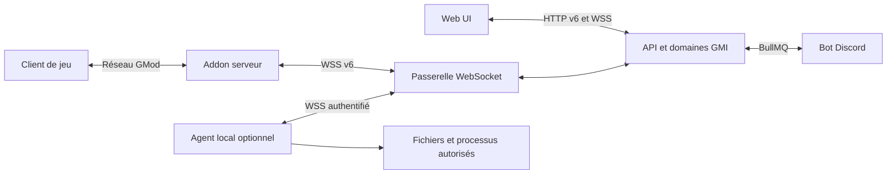

# GMI v6 et spécification de la prochaine version

**Statut : proposition de périmètre produit et technique. Date : 20 novembre 2026.**

Gmod Integration v6 doit réunir la gestion des serveurs Garry’s Mod, Discord et les outils de diagnostic dans
une Web UI complète. L’addon Lua utilisera une connexion WebSocket persistante pour tous ses échanges avec
GMI. L’API sera versionnée sous `/v6/`. Les fonctionnalités déjà annoncées devront être livrées et utilisables,
avec des achats à la carte, un Premium regroupant les fonctionnalités et un abonnement annuel.

Cette spécification décrit le comportement attendu de **GMI 6.0.0**, puis les règles d’évolution des versions
**6.x.x**. Elle ne constitue pas une annonce de disponibilité. Les montants, quotas et interprétations encore
ouverts sont regroupés dans les décisions à prendre avant commercialisation.

## Objectifs de la v6

- Utiliser exclusivement WebSocket pour le trafic applicatif de l’addon Lua, côté serveur comme côté client.
- Proposer une API HTTP cohérente sous `/v6/` pour le site, les intégrations et l’administration.
- Terminer les fonctionnalités promises, avec une configuration et des permissions cohérentes dans Discord,
  le jeu et la Web UI.
- Administrer un serveur à distance : console GMod, fichiers, configuration et commandes système lorsque
  l’agent local est installé et autorisé.
- Relier les erreurs Lua à leur contexte et proposer des correctifs consultables et applicables, avec
  sauvegarde et restauration des fichiers modifiés.
- Permettre de choisir quelques fonctionnalités ou de prendre le Premium complet, au mois ou à l’année.
- Migrer les installations, les données et les achats existants sans réinitialisation de la communauté.

Une fonctionnalité est terminée lorsque son parcours fonctionne de bout en bout : addon si nécessaire,
traitement métier, stockage, Discord, Web UI, droits d’accès, documentation et vérification du résultat.
Un bouton, un endpoint ou une mention « bientôt » ne suffit pas à valider sa livraison.

## Architecture et versionnement

### API v6

Les routes métier HTTP seront exposées sous `/v6/`, avec une documentation des requêtes, réponses, erreurs,
permissions et limites. Le site utilisera cette version. Les webhooks de paiement pourront conserver des
routes spécifiques au prestataire, documentées séparément.

Les versions du produit et du protocole seront distinguées : `6.0.1` pourra corriger l’addon sans changer le
contrat `/v6/`. Une version mineure ajoutera des champs ou des fonctionnalités compatibles. Une rupture de
contrat public demandera une nouvelle version majeure d’API.

Le dépôt utilise actuellement des routes `/v3/`. La migration devra organiser leur coexistence avec `/v6/`
pendant une période annoncée. L’ajout d’un simple alias `/v6/` vers les handlers historiques ne suffira pas :
les contrats, l’authentification et les comportements devront être définis et vérifiés.

### Connexion WebSocket de l’addon

L’addon serveur ouvrira une connexion **WSS** authentifiée vers la passerelle v6, sur un chemin cible `/v6/`
du service WebSocket. Il annoncera sa version, son identifiant de serveur et ses capacités disponibles.
Le premier appairage utilisera un secret fourni lors de l’installation ; il ne dépendra pas d’un appel HTTP
Lua préalable.

Tous les échanges applicatifs passeront par cette connexion : authentification, configuration, joueurs,
statistiques, chat, logs, erreurs, captures, rapports de bugs, modération, commandes et transferts de fichiers.
Les événements des clients de jeu seront transmis par le réseau GMod au serveur, puis par WSS à GMI.
Les secrets GMI resteront exclusivement côté serveur.

Le serveur déduira l’identité du joueur de sa connexion et vérifiera le schéma, les permissions, la taille et
la fréquence de chaque message reçu. Les captures client seront fragmentées avec des limites de taille
totale et de durée d’assemblage. Un identifiant fourni dans le message ne permettra pas de choisir une
autre identité, un autre serveur ou une autre communauté.

Le remplacement concernera aussi les téléchargements et vérifications de version aujourd’hui effectués en
HTTP par l’addon. La cible est **zéro requête HTTP applicative émise par le code Lua de GMI**, y compris ses
outils de mise à jour. L’installation d’une dépendance native se fera par l’hébergeur ou l’agent local.
Le handshake standard du protocole WebSocket reste nécessaire ; le navigateur, les services GMI et les
prestataires externes pourront continuer à utiliser HTTP.

### Fiabilité des échanges

Les messages partageront une enveloppe versionnée : type, identifiant unique, corrélation de réponse,
session, numéro de séquence et données validées. Les événements, requêtes, réponses et erreurs auront des
types explicites, communs au backend et à l’addon.

- La connexion disposera d’un heartbeat, d’une reconnexion avec délai progressif et variation aléatoire,
  puis d’une reprise de session ou d’une resynchronisation complète si la reprise est impossible.
- Les événements persistants auront des accusés de réception et une reprise bornée. Les mesures périmées
  pourront être abandonnées. Les limites de mémoire, de disque et de débit seront explicites.
- Les actions sensibles utiliseront un identifiant d’exécution, une expiration et une déduplication persistée.
  Une reconnexion ne devra pas réexécuter aveuglément une commande, une sanction ou une récompense.
- L’interface distinguera une action reçue par GMI, remise à l’addon, exécutée et confirmée. Une coupure après
  exécution pourra produire un résultat inconnu à vérifier, sans annoncer un succès ni relancer automatiquement.
- Les captures, fichiers et flux seront découpés en blocs avec limites de taille et contrôle d’intégrité.
  Ils ne devront pas bloquer les échanges de contrôle ni saturer la boucle de jeu.
- Un serveur hors ligne conservera son fonctionnement local. Les commandes sensibles ne seront pas mises
  en attente indéfiniment ; les événements repris afficheront leur date réelle.

### Répartition dans le monorepo

L’API et la passerelle WebSocket resteront des points d’entrée minces. Les traitements métier partagés
resteront dans `packages/core` et `packages/domain-*`, les contrats dans `packages/schema` et les adaptations
techniques dans `packages/infra-*`. Les actions Discord continueront à passer par BullMQ.

La livraison entre plusieurs instances WebSocket devra identifier la session propriétaire et obtenir un
résultat d’exécution de l’addon. Un message accepté par Redis ou une queue ne constitue pas une confirmation
d’exécution. Les nouvelles capacités pourront justifier des domaines dédiés aux droits commerciaux, aux
opérations distantes et aux correctifs, en respectant les dépendances existantes.

## Fonctionnalités existantes à reprendre

Chaque ligne décrit le périmètre à conserver et à vérifier avec la nouvelle architecture. Les achats à la
carte concerneront des capacités avancées identifiées ; les droits gratuits et les achats historiques devront
être traités explicitement lors de la migration.

| Ensemble                      | Comportement attendu en v6                                                                                                                                                                                   |
| ----------------------------- | ------------------------------------------------------------------------------------------------------------------------------------------------------------------------------------------------------------ |
| Installation et configuration | Appairage guidé, gestion multiserveur, paramètres synchronisés, diagnostic de connexion et détection des dépendances manquantes.                                                                             |
| Statut serveur                | Carte, joueurs, disponibilité, ancienneté de la dernière information, message Discord actualisé, variables et boutons configurables. Un serveur déconnecté ne garde pas artificiellement un statut en ligne. |
| Chat                          | Relais GMod vers Discord et Discord vers GMod selon les droits, formats personnalisables, filtres, protection des mentions et prévention des boucles.                                                        |
| Identité et vérification      | Liaison Steam et Discord, vérification, liaison obligatoire si configurée, attribution et retrait des rôles, messages personnalisables et gestion des comptes déjà liés.                                     |
| Pseudos et rôles              | Synchronisation des pseudos, préfixes, suffixes, groupes utilisateur et rôles Discord selon l’équipe ou le métier. Direction, conflits et hiérarchie Discord sont configurables.                             |
| Modération                    | Bans, débannissements, warns, timeouts et kicks, avec correspondance des identités, direction configurée, motif, auteur et historique. Les protections contre les boucles sont communes à tous les parcours. |
| Maintenance                   | Mode maintenance, liste d’accès et exceptions administrateur, avec état visible dans le jeu et le dashboard.                                                                                                 |
| Logs                          | Consultation, filtres, recherche, relais Discord, masquage des données sensibles, export et durée de conservation affichée.                                                                                  |
| Déclencheurs                  | Règles sur les événements et valeurs des logs, comparateurs et notifications ou actions autorisées, avec délai minimal entre déclenchements et journal d’exécution.                                          |
| Erreurs Lua                   | Collecte serveur et client, trace, fichier, ligne, version, regroupement des occurrences et suivi de résolution.                                                                                             |
| Rapports de bugs              | Saisie en jeu, étapes de reproduction, résultat attendu et obtenu, capture facultative, suivi et consultation par le staff.                                                                                  |
| Captures                      | Demande autorisée, galerie, métadonnées, description et relais Discord, avec limites de fréquence, taille et conservation.                                                                                   |
| Joueurs et profils            | Base joueurs, recherche, comptes liés, groupes, temps de jeu, sanctions et profils. Les indicateurs comme le trust factor doivent avoir une signification expliquée.                                         |
| Statistiques et classements   | Statistiques standard et personnalisées, classements, périodes et remise à zéro contrôlée. Une reconnexion ne doit pas compter deux fois la même progression.                                                |
| Votes et visibilité           | Liste publique des serveurs, votes, bump et classement, avec protection contre les doublons et règles de délai explicites.                                                                                   |
| Gestion Discord               | Liens communautaires, autorôles, configuration de la guilde et bot personnalisé selon les droits acquis.                                                                                                     |
| Administration distante       | Console GMod et commandes depuis Discord et la Web UI, avec contrôle des droits et résultat traçable.                                                                                                        |
| Auto-hébergement              | Installation documentée du backend, des dépendances, de l’addon et de l’agent local optionnel ; sauvegarde, mise à jour et restauration.                                                                     |
| Mise à jour                   | Versions compatibles annoncées par WSS, contrôle d’intégrité, installation sur disque par un composant autorisé et possibilité de revenir à la version précédente.                                           |

## Fonctionnalités promises à terminer

Ces fonctionnalités font partie de la cible **6.0.0**. Si l’une reste incomplète, la version pourra être testée
en alpha ou bêta ; la promesse de livraison complète devra attendre sa validation.

| Fonctionnalité      | Livraison attendue                                                                                                                          | Critère de validation                                                                                                                                                                                    |
| ------------------- | ------------------------------------------------------------------------------------------------------------------------------------------- | -------------------------------------------------------------------------------------------------------------------------------------------------------------------------------------------------------- |
| Vocaux par équipe   | Association entre équipes en jeu et salons vocaux Discord, règles d’accès et nettoyage des salons temporaires.                              | Un changement d’équipe met à jour les droits et déplace un membre déjà connecté selon la configuration, sans tenter de le connecter de force au vocal.                                                   |
| Alertes de statut   | Notifications de connexion, déconnexion, reprise et maintenance ; messages standard ou personnalisés.                                       | Une coupure provoque une seule alerte après le délai configuré ; la reprise actualise le statut sans spam.                                                                                               |
| Kicks synchronisés  | Expulsion entre GMod et Discord selon une direction choisie et une identité liée.                                                           | Une expulsion n’est appliquée qu’une fois, ne devient pas un ban et n’est pas rejouée sur une nouvelle session.                                                                                          |
| Tickets Discord     | Ouverture, catégories, attribution, échanges, fermeture et transcription accessibles au staff autorisé.                                     | Le cycle complet fonctionne et un membre extérieur au ticket ne peut pas en consulter le contenu.                                                                                                        |
| Tickets liés au jeu | Création depuis GMod, liaison au joueur et au serveur, échanges suivis dans Discord et la Web UI.                                           | Le joueur retrouve son dossier et la réponse du staff ; tickets et rapports de bugs peuvent être reliés.                                                                                                 |
| Suggestions         | Publication, votes, modération, états accepté ou refusé et réponse du staff.                                                                | Les votes sont uniques par compte et le changement d’état est conservé dans l’historique.                                                                                                                |
| Récompenses         | Attribution sur vérification, vote, temps de jeu ou événement configuré, via des intégrations déclarées.                                    | Une même condition ne donne pas deux fois la récompense ; une attribution en attente pour un joueur hors ligne reste suivie et bornée.                                                                   |
| Forwards            | Proposition fonctionnelle : règles de transfert d’événements ou messages vers des destinations Discord autorisées, avec filtres et formats. | Une règle est testable avant activation, respecte les permissions et évite les boucles. Le sens du module reste à confirmer.                                                                             |
| Streams             | Proposition fonctionnelle : sessions de captures successives d’un joueur pour le diagnostic, visibles dans la Web UI, à cadence limitée.    | La session peut être démarrée et arrêtée par un rôle autorisé, expire automatiquement et respecte les quotas. Le sens du module reste à confirmer ; aucune promesse de vidéo haute fréquence à ce stade. |

Les intitulés « Forwards » et « Streams » existent dans la navigation mais ne définissent pas encore un
comportement produit assez précis. Leur définition devra être arrêtée avant de figer les contrats et la
communication commerciale. Leur présence dans ce tableau ne valide pas les interprétations proposées.

## Fichiers et commandes à distance

### Explorateur et éditeur de fichiers

La Web UI proposera une arborescence, une recherche et la lecture des fichiers autorisés : données GMI,
configuration, logs et sources d’addons lorsque l’environnement les rend accessibles. Elle affichera la taille,
la date, l’origine du fichier et les capacités de lecture ou d’écriture réellement disponibles.

Le mode édition ajoutera un aperçu des différences, une sauvegarde avant modification, la vérification
que le fichier n’a pas changé entre lecture et écriture, puis une restauration de la version précédente.
Les répertoires et extensions accessibles seront définis localement par le propriétaire du serveur.

Les possibilités du Lua standard sont limitées : `file.Read` utilise les chemins virtuels de GMod et
`file.Write` écrit sous `data/`, avec une liste d’extensions autorisées qui ne comprend pas `.lua`.
L’édition persistante des sources Lua nécessitera donc le composant local décrit ci-dessous.
[Références Facepunch sur la lecture](https://wiki.facepunch.com/gmod/file.Read) et
[sur l’écriture](https://wiki.facepunch.com/gmod/file.Write).

### Console GMod et scripts GLua

La console distante permettra d’envoyer une commande GMod, de consulter les sorties disponibles et de
retrouver son auteur et son résultat. Les commandes prises en charge et leurs limites seront documentées.
Une opération demandant un changement de carte ou un redémarrage affichera son effet attendu.

Un outil distinct pourra exécuter un extrait GLua serveur pour le diagnostic, avec une permission dédiée,
le code exact présenté et une trace d’exécution. Cette capacité ne devra pas être accessible à tous les
administrateurs Discord par défaut. Le rechargement d’un fichier restera explicite, car les hooks, timers
et états déjà créés peuvent demander un redémarrage propre.

Une commande de console GMod n’est pas une commande du système d’exploitation.
[Référence Facepunch sur les commandes de console](https://wiki.facepunch.com/gmod/Global.RunConsoleCommand).

### Agent local pour les opérations système

Un agent complémentaire, installé par le propriétaire sur la machine ou intégré à son panel d’hébergement,
permettra l’écriture des scripts sur disque, les commandes système autorisées et le contrôle du processus
de jeu. Il disposera de sa propre identité et de sa propre connexion WSS ; son installation sera optionnelle.
Sans lui, l’interface affichera précisément les opérations disponibles avec l’addon seul.

La bibliothèque `os` exposée par GMod se limite aux opérations de date et d’heure ; le Lua de l’addon ne
fournit donc pas à lui seul un shell système. [Référence Facepunch](https://wiki.facepunch.com/gmod/os).

L’agent exécutera des tâches définies localement avec paramètres validés, répertoire de travail, délai,
limites de sortie et utilisateur système dédié. Un terminal libre pourra être une capacité séparée activée
par le propriétaire. Les chemins seront normalisés, les sorties des racines autorisées et les liens vers
ces sorties seront refusés. Les fichiers de secrets seront exclus des consultations et des analyses.

Le redémarrage sera effectué par l’agent ou par un adaptateur de panel : un addon arrêté avec le serveur
ne peut pas assurer seul sa remise en route. La matrice des systèmes, architectures et panels pris en
charge devra accompagner la livraison.

## Diagnostic et propositions de correction

Une erreur Lua pourra ouvrir un dossier regroupant sa trace, ses occurrences, les versions concernées
et les extraits autorisés des fichiers impliqués. L’administrateur pourra demander une explication et une
proposition de correction automatique, éventuellement assistée par IA.

Le parcours attendu est le suivant :

1. Regrouper les erreurs identiques et identifier le fichier, la ligne, le realm et le contexte disponibles.
2. Sélectionner les extraits utiles ; afficher les données qui seront transmises au service d’analyse.
3. Produire une explication, un correctif sous forme de différences et les vérifications proposées.
4. Vérifier la syntaxe GLua, les conventions `sv_`, `cl_`, `sh_` et les références accessibles. Une compilation
   sans exécution peut vérifier la syntaxe, sans prouver le fonctionnement du correctif.
5. Présenter le patch, les fichiers touchés, les effets attendus et les éventuels besoins de redémarrage.
6. Tester le patch dans un environnement de validation lorsque disponible, avant toute application en
   production. Présenter le résultat de ces vérifications à l’utilisateur qui décide du déploiement.
7. Après validation d’un utilisateur autorisé, sauvegarder les originaux et appliquer le patch via l’agent
   local, uniquement si les empreintes des fichiers correspondent toujours aux versions analysées.
8. Observer les nouvelles occurrences après déploiement. Permettre de restaurer les fichiers et indiquer
   si un redémarrage est nécessaire.

`CompileString` compile du code sans l’exécuter automatiquement ; cette vérification ne remplace pas les
tests du comportement en jeu. [Référence Facepunch](https://wiki.facepunch.com/gmod/Global.CompileString).

Les statuts du dossier seront distincts : détectée, analysée, correction proposée, approuvée, appliquée,
en observation, résolue ou restaurée. L’absence temporaire d’erreur ne suffira pas à annoncer une résolution
certaine. Sans accès aux sources, GMI pourra proposer un diagnostic ou un patch téléchargeable ; sans agent
local, il ne promettra pas une modification persistante sur disque.

Une restauration remettra en place les fichiers sauvegardés. Elle n’annulera pas les effets déjà produits
en mémoire, en base de données ou dans un service externe ; le dossier indiquera les actions complémentaires
nécessaires pour rétablir le fonctionnement attendu.

Les fichiers collectés seront traités comme des données à analyser. Leur contenu ne pourra pas autoriser
de nouvelles commandes ou élargir les permissions de l’outil. Les secrets, fichiers hors périmètre et sources
que l’utilisateur n’est pas autorisé à transmettre seront exclus. Les conditions de conservation et le
coût ou quota d’analyse seront affichés avant activation du service.

La cible initiale est la **proposition automatique avec application validée**. Une application autonome
pour certaines règles connues pourra être étudiée en version mineure, avec activation explicite et possibilité
de restauration. Elle ne constitue pas une condition de sortie de la 6.0.0.

## Web UI complète

La Web UI réunira une vue de la communauté, une vue par serveur et un espace de gestion des achats.
Les données actualisées en direct afficheront leur date et l’état de connexion. La reconnexion ne devra
pas effacer un formulaire en cours ni présenter une ancienne valeur comme une mesure actuelle.

| Espace                   | Contenu attendu                                                                                       |
| ------------------------ | ----------------------------------------------------------------------------------------------------- |
| Accueil de communauté    | Serveurs, connexion, alertes, activité récente et accès aux réglages Discord.                         |
| Vue serveur              | Carte, joueurs, statut, événements et actions autorisées ; accès aux intégrations installées.         |
| Console et fichiers      | Console GMod, explorateur, éditeur, historique et capacités de l’agent local.                         |
| Erreurs et correctifs    | Recherche, regroupement, diagnostic, différences, validation, suivi et restauration.                  |
| Communauté et modération | Vérification, rôles, pseudos, équipes, vocaux, sanctions, maintenance et récompenses.                 |
| Support et activité      | Tickets, suggestions, bugs, captures, flux, logs, déclencheurs et transferts.                         |
| Statistiques             | Joueurs, profils, valeurs personnalisées, classements et votes.                                       |
| Boutique et facturation  | Catalogue, achats, Premium mensuel ou annuel, droits actifs, consommation et renouvellement.          |
| Administration           | Collaborateurs, permissions, jetons, intégrations, paramètres de conservation et journal des actions. |

Chaque page aura des états de chargement, absence de données, erreur et absence de permission. Les formulaires
seront utilisables au clavier, sur mobile et en français comme en anglais. Une fonctionnalité non achetée
affichera son périmètre et son prix ; une fonctionnalité incompatible avec l’hébergement expliquera la
capacité manquante avant l’achat.

## Achats de fonctionnalités et Premium

### Structure des offres proposée

L’achat activera un droit sur une communauté Discord identifiée, avec des serveurs et quotas explicitement
définis. Le catalogue distinguera le droit d’utiliser une fonction, ses limites de consommation et les
permissions administratives nécessaires pour l’exécuter.

| Offre              | Accès                                                                                                   | Période proposée                                                                                                                                                              |
| ------------------ | ------------------------------------------------------------------------------------------------------- | ----------------------------------------------------------------------------------------------------------------------------------------------------------------------------- |
| Gratuit            | Socle de connexion, configuration et fonctions gratuites définies dans la grille v6.                    | Sans abonnement.                                                                                                                                                              |
| À la carte         | Achat d’un module précis, par exemple Server Status avancé, sans obligation de prendre le Premium.      | Licence permanente pour les modules éligibles ; abonnement mensuel ou annuel pour les services récurrents, indiqué avant achat. La liste des modules éligibles reste à fixer. |
| Premium mensuel    | Ensemble des modules du catalogue v6 inclus pendant l’abonnement, avec les quotas publiés.              | Paiement mensuel.                                                                                                                                                             |
| Premium annuel     | Même ensemble fonctionnel que le Premium mensuel.                                                       | Paiement annuel avec tarif et éventuelle remise annoncés.                                                                                                                     |
| Droits historiques | Achats GmodStore, abonnements et avantages déjà acquis, selon une table de correspondance de migration. | Respect de la durée et du périmètre acquis.                                                                                                                                   |

Le Premium constituera le pack complet : les modules inclus seront utilisables directement pendant sa
validité. Les achats à la carte resteront attachés à la communauté après sa fin selon leur propre durée.
Un coût de consommation additionnel, par exemple des crédits d’analyse IA, devra être distingué de l’accès
à la fonctionnalité et annoncé clairement.

### Exemple du module Server Status

Un administrateur pourra acheter uniquement le module de statut avancé pour obtenir la personnalisation,
les boutons et les alertes correspondant à son offre, tout en conservant le reste de GMI en gratuit.
Le même module sera inclus dans le Premium. Les capacités de statut aujourd’hui gratuites devront être
identifiées dans la grille de migration avant de décider ce qui devient payant.

Les autres modules pourront couvrir les logs avancés, la personnalisation du chat, les synchronisations
avancées, les outils de communauté, la console et les fichiers, ou le diagnostic assisté. Le découpage et
le prix de chaque module devront être publiés avec ses dépendances. Une dépendance technique partagée,
comme le transport WSS, ne devra pas imposer l’achat d’un deuxième module caché.

### Doublement du Premium et abonnement annuel

**Hypothèse de travail à confirmer : « doublé » signifie doubler le prix du Premium mensuel.** Aucun
doublement des quotas n’est déduit de cette hypothèse.

Le code du site affiche une base de **7,99 $ par mois** et un achat historique de **69,99 $ à vie**.
Ces montants servent ici de référence au calcul ; ils ne constituent pas une vérification des tarifs
réellement facturés par les prestataires.

| Élément                               | Calcul illustratif                                                 | Statut                               |
| ------------------------------------- | ------------------------------------------------------------------ | ------------------------------------ |
| Premium mensuel v6                    | 7,99 $ × 2 = **15,98 $ par mois**.                                 | Hypothèse, tarif final à fixer.      |
| Premium annuel sans remise            | 15,98 $ × 12 = **191,76 $ par an**.                                | Base de comparaison.                 |
| Premium annuel avec deux mois offerts | 15,98 $ × 10 = **159,80 $ par an**, soit environ 16,7 % de remise. | Variante proposée, remise à décider. |

Le tarif affiché devra préciser la devise, le traitement des taxes, l’unité facturée, les quotas et le prix
de renouvellement. Le montant mensuel équivalent d’un abonnement annuel devra être accompagné du total
effectivement prélevé. Un nouveau Premium à vie n’est pas défini par cette proposition ; l’achat historique
ne doit pas être automatiquement multiplié par deux.

### Règles de gestion des droits

- Un catalogue central définira les modules, offres, prix par période, capacités, quotas et dépendances.
  Le backend sera la source de vérité pour les droits et leurs dates de validité.
- Les droits achetés, inclus dans le Premium et historiques se cumuleront selon des règles publiées.
  Une même fonctionnalité incluse deux fois ne doublera pas automatiquement un quota.
- Le paiement sera confirmé côté serveur par un événement vérifié du prestataire. Les événements reçus
  plusieurs fois, en retard ou dans le désordre ne devront pas accorder deux fois un achat.
- Le produit ou SKU, la communauté, le statut du paiement et les dates seront vérifiés côté serveur. Une
  réconciliation périodique avec le prestataire corrigera les événements manqués. Une révocation retirera
  uniquement les droits de sa propre source, en conservant les autres achats et abonnements valides.
- Les changements d’offre, annulations, paiements échoués, remboursements et contestations auront des états
  distincts et des règles de prise d’effet. Une simple redirection de paiement ne suffira pas à activer un droit.
- L’annulation arrêtera le renouvellement selon l’échéance du contrat. À expiration, les capacités payantes
  concernées seront désactivées ; les données suivront la politique de conservation affichée, sans suppression
  immédiate déclenchée par la seule fin d’abonnement.
- Le traitement des modules déjà achetés lors d’un passage au Premium sera défini avant lancement : avoir,
  prorata ou coexistence sans remise automatique. Aucun remboursement implicite ne sera promis.
- La Web UI, Discord, l’API et la passerelle appliqueront les mêmes droits. L’expiration ou la révocation
  devra aussi invalider les autorisations des connexions déjà ouvertes.
- L’auto-hébergement distinguera les fonctions locales des services hébergés nécessitant un abonnement.
  Son périmètre commercial devra être annoncé avec la grille des offres.

### Données commerciales à prévoir

Les achats multiples nécessiteront des enregistrements distincts pour les produits, offres, prix versionnés
par devise et période, commandes et lignes d’achat, abonnements avec échéances, droits par capacité et source,
événements fournisseur dédupliqués et compteurs de consommation. Un simple booléen Premium ou un achat
unique rattaché à un identifiant Steam ne représentera pas ce catalogue.

Chaque droit précisera sa communauté, sa source, sa capacité, son début, sa fin éventuelle et son statut.
Les droits historiques seront importés avec leur origine, puis comparés avant et après migration. Le moteur
calculera l’accès effectif à partir de toutes les sources valides, indépendamment des permissions de l’acteur.

## Permissions et journal des actions

Un rôle Discord donnant accès au dashboard ne donnera pas automatiquement accès au système de fichiers,
au shell ou à l’application des correctifs. Les permissions seront définies par communauté, serveur et action,
avec au minimum la consultation, la modération, la configuration et les opérations techniques séparées.

Les autorisations seront revérifiées avant chaque action sensible et lors de son exécution différée. Le
propriétaire pourra couper les opérations distantes et révoquer un jeton depuis le serveur local. Les secrets
ne seront pas placés dans les URL ou les journaux ; les sessions Web UI utiliseront une authentification
adaptée aux navigateurs et des jetons de connexion courts si nécessaire.

Le journal indiquera l’acteur, la communauté, le serveur, la date, l’action, son statut et la corrélation avec
le résultat. Les modifications de fichiers conserveront les empreintes et références de sauvegarde.
La consultation des données, captures et sources restera soumise aux permissions et à leur conservation
configurée ; les mécanismes d’export et d’effacement devront couvrir les nouvelles données v6.

## Migration vers la v6

La migration sera progressive et réversible. Le transport historique restera disponible pour les installations
non migrées pendant la période de coexistence ; un addon v6 n’utilisera pas de repli HTTP caché.

1. **Inventorier et sauvegarder** les serveurs, configurations, identités liées, sanctions, logs utiles,
   achats et abonnements, puis associer chaque fonction existante à une capacité v6.
2. **Préparer le backend v6** avec les contrats, droits et migrations de données. Les anciennes et nouvelles
   routes utiliseront la même source de vérité ou une conversion explicite pour éviter les divergences.
3. **Tester un serveur pilote** avec WSS et les droits migrés. Vérifier les dépendances natives et les fonctions
   avec ou sans agent local, sans modifier l’ensemble d’une communauté d’un seul coup.
4. **Migrer l’addon et la Web UI** en conservant les identifiants et en convertissant les configurations
   persistées. Les changements de jetons seront accompagnés d’un parcours de réappairage.
5. **Migrer les achats** selon leur origine, communauté, durée et avantages. Les fonctions déjà acquises à vie
   devront rester accessibles ; les nouveaux services consommables auront des conditions distinctes.
6. **Ouvrir la version stable** après validation du périmètre complet, avec documentation, notes de version,
   assistance et procédure de restauration testée.
7. **Retirer les anciennes routes** seulement après l’échéance annoncée et vérification de l’usage restant.

Les abonnements existants ne recevront pas une hausse silencieuse : les nouveaux tarifs et leur date de
prise d’effet devront être présentés selon le parcours du prestataire retenu. Les droits exclusifs historiques,
notamment le bot personnalisé lié à GmodStore, feront partie de la table de migration.

## Lots de réalisation

### Premier parcours engagé — 21 novembre 2026

Le premier contrat HTTP indépendant `/v6/account/erasure-requests` et le parcours d'effacement du compte
sont implémentés : confirmation explicite, reçu de suivi après révocation des sessions, traitement SQL
durable avec reprise et nettoyage des stockages personnels. La preuve de demande, les bans globaux actifs
et la réputation utile sont séparés du profil supprimé ; les droits collectifs existants restent gérés.
Voir le [contrat API](./apps/api.md#account-erasure-under-v6) et le
[fonctionnement du domaine conformité](./packages/domain-compliance.md) pour le périmètre et les limites.

Ce parcours nécessite sa migration de données et une clé de pseudonymisation dédiée avant activation.
Il ne signifie pas que le transport WSS, la boutique ou les autres parcours v6 sont déjà migrés ; les lots
ci-dessous restent la cible de réalisation et les conditions de sortie restent applicables.

Les sauvegardes de sections du dashboard utilisent également des contrats indépendants v6 : réglages
groupés du serveur/de la communauté et configuration complète du statut Discord. Les réglages d’une
section sont persistés dans une transaction ; le statut associe message, formats et boutons avec contrôle
de révision. L’interface utilise des brouillons explicites et sépare sauvegarde et publication. Voir les
[contrats de sauvegarde](./apps/api.md#dashboard-section-saves-under-v6) et le
[catalogue des composants](./apps/website-ui.md#interaction-contracts). Les lectures et créations restantes
conservent encore leurs routes historiques pendant cette migration.

| Lot                     | Résultat attendu                                                                                                      | Dépendance principale                                              |
| ----------------------- | --------------------------------------------------------------------------------------------------------------------- | ------------------------------------------------------------------ |
| 1 Contrats et périmètre | Inventaire des parcours, contrats HTTP et WSS v6, définitions de Forwards et Streams, grille de migration des droits. | Arbitrages produit et commerciaux.                                 |
| 2 Transport et données  | Appairage, authentification, reconnexion, reprise, déduplication, transfert par blocs et stockage compatible.         | Contrats stabilisés.                                               |
| 3 Reprise fonctionnelle | Toutes les fonctions existantes fonctionnent avec l’addon v6 ; aucun appel HTTP applicatif Lua ne subsiste.           | Transport disponible.                                              |
| 4 Promesses restantes   | Vocaux, alertes, kicks, tickets, suggestions, récompenses, Forwards et Streams livrés avec leurs parcours complets.   | Contrats métier et transport.                                      |
| 5 Outils techniques     | Agent local, console, fichiers, sauvegardes, propositions de correctifs et restauration.                              | Permissions, contrats d’opérations et compatibilité d’hébergement. |
| 6 Boutique et Web UI    | Catalogue, achats unitaires, Premium mensuel et annuel, gestion des droits et pages complètes.                        | Catalogue commercial et prestataire de paiement.                   |
| 7 Migration et sortie   | Pilote, bêta, reprise des achats, restauration, documentation et validation de sortie.                                | Ensemble du périmètre validé.                                      |

Les travaux indépendants pourront avancer en parallèle. Aucune date de sortie n’est fixée ici ; une date
fiable demandera une estimation des lots et le résultat du pilote.

## Conditions de sortie de la version stable

- Toutes les lignes des deux matrices fonctionnelles disposent d’un parcours vérifié et d’une documentation.
  Forwards et Streams ont une définition arrêtée et un résultat validé.
- Les contrats `/v6/` et WSS sont documentés, validés sur les deux côtés et testés avec les versions compatibles.
- Une recherche statique et une observation du trafic confirment l’absence d’appels HTTP applicatifs dans
  le Lua GMI, y compris les captures client, bugs, erreurs et outils de mise à jour.
- Les coupures, redémarrages et changements d’instance WebSocket n’entraînent pas de double sanction,
  récompense ou commande. Les pertes et résultats inconnus sont visibles et traités.
- Les essais de permissions couvrent l’accès entre communautés, les sessions révoquées, les commandes,
  les fichiers hors racine et les changements de droits pendant une connexion ouverte.
- La modification d’un fichier et l’application d’un correctif ont été validées avec conflit de version,
  échec d’écriture et restauration. Les environnements sans agent affichent leurs capacités réelles.
- Les paiements ont été testés avec renouvellement annuel, événements en double ou désordonnés, expiration,
  remboursement, changement d’offre et conservation des achats historiques.
- Après expiration du Premium, un module acheté définitivement reste utilisable. Le remboursement d’un
  abonnement ne retire pas un droit encore accordé par un autre achat valide.
- La migration et le retour à une version compatible ont été testés sur un jeu de données représentatif.
- Les budgets de charge sont fixés et mesurés : connexions, événements, débit, mémoire, disque, temps de
  traitement et impact sur le serveur de jeu. Aucun débit illimité n’est déduit du Premium.
- Les métriques, alertes et procédures d’exploitation couvrent les connexions, retards, pertes, erreurs et
  résultats des opérations, sans journaliser les secrets ou le contenu privé inutilement.

## Décisions à arrêter avant commercialisation

| Décision                     | Proposition de départ                                                                                                                                        |
| ---------------------------- | ------------------------------------------------------------------------------------------------------------------------------------------------------------ |
| Sens du Premium « doublé »   | Prix mensuel multiplié par deux ; confirmer s’il s’agit plutôt des quotas ou des deux.                                                                       |
| Premium complet              | Tous les modules v6 inclus pendant l’abonnement ; quotas et éventuels crédits consommables affichés séparément.                                              |
| Prix et annuel               | Fixer les montants, la devise et la remise annuelle ; les calculs ci-dessus restent illustratifs.                                                            |
| Achats à la carte            | Définir chaque module, son unité, son prix, sa durée et les modules achetables définitivement.                                                               |
| Socle gratuit et limites     | Publier les fonctions gratuites, quotas de serveurs, stockage, rétention, transferts et analyses. Traiter explicitement les anciennes mentions « illimité ». |
| Forwards et Streams          | Confirmer le sens des deux fonctions avant de transformer les propositions en engagements.                                                                   |
| Agent local                  | Choisir les systèmes, architectures et panels pris en charge, puis les capacités du terminal libre.                                                          |
| Analyse assistée             | Choisir le service d’analyse, les données transmises, leur conservation et le budget inclus.                                                                 |
| Migration commerciale        | Arrêter la correspondance des droits existants, le traitement des achats à vie et des abonnements en cours.                                                  |
| Paiement et auto-hébergement | Choisir un prestataire compatible avec les offres et préciser les fonctions disponibles localement.                                                          |

## Références du projet

- [Architecture actuelle](./architecture.md), [API](./apps/api.md), [passerelle WebSocket](./apps/websocket.md)
  et [addon Lua](./submodules/gmod-integration.md).
- [Introduction produit](../apps/docs/docs/introduction.md) et
  [guides du dashboard](../apps/docs/docs/guides/dashboard/server).
- [Comparatif Premium et fonctions en développement](../apps/website/src/pages/Premium.tsx),
  [navigation et fonctions annoncées](../apps/website/src/components/layout/menu/DashboardMenu.tsx) et
  [routes du dashboard](../apps/website/src/index.tsx).
- [Activation des achats historiques](../apps/docs/docs/getting-started/activation_premium.md),
  [bot personnalisé](../apps/docs/docs/guides/dashboard/guild/custom_bot.md),
  [auto-updater annoncé](../apps/docs/docs/others/auto-updater.md) et
  [installation de GWSockets](../apps/docs/docs/others/gwsockets.md).
